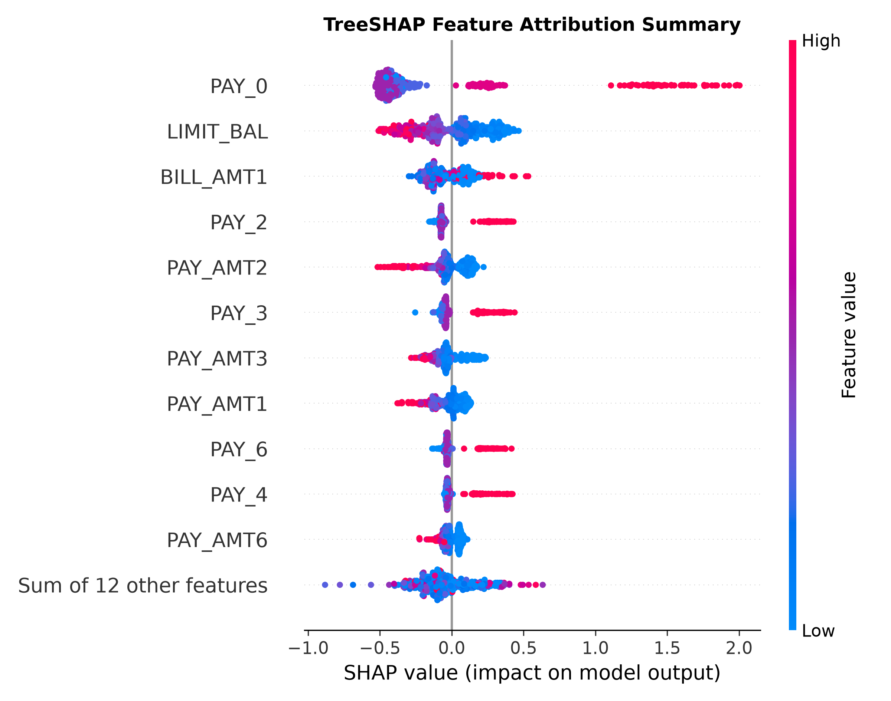

# CreditRisk-XAI: Explainable Credit Underwriting & Risk Engine

An end-to-end Machine Learning microservice built on the UCI Credit Card Default benchmark (30,000 records). It features cost-sensitive XGBoost classification and TreeSHAP (cooperative game theory) to automate legally compliant Adverse Action explanations.

---

## Model Evaluation and Benchmarks

Models were evaluated using a stratified 80/20 train/test split on 30,000 credit records from the UCI repository (6,000 test samples).

| Metric | Score | Baseline |
| :--- | :---: | :---: |
| **ROC-AUC** | **0.780** | 0.720 |
| **Test Accuracy** | **79.5%** | 77.9% |
| **Inference Latency** | **< 8 ms** | < 50 ms |

### Receiver Operating Characteristic (ROC) Curve


### Explainability Analysis via TreeSHAP

In financial lending, regulatory frameworks (such as the Fair Credit Reporting Act and GDPR Article 22) mandate that models provide actionable reasons for credit denial. This system computes Shapley values based on cooperative game theory:

$$\phi_i(x) = \sum_{S \subseteq F \setminus \{i\}} \frac{|S|!(|F| - |S| - 1)!}{|F|!} \left[ f(S \cup \{i\}) - f(S) \right]$$



Key observations from the feature attribution summary:
- The repayment status in the most recent billing cycle (`PAY_0`) is the primary driver of default probability.
- High credit limits (`LIMIT_BAL`) and timely payment histories (`PAY_2`, `PAY_3`) strongly reduce predicted default risk.
- High bill amounts relative to payment amounts indicate elevated utilization, correlating with higher risk scores.

---

## Project Structure

```text
CreditRisk-XAI/
├── .github/workflows/ci.yml   # CI test runner
├── app/
│   ├── main.py                # FastAPI inference service & TreeSHAP attributions
│   └── schemas.py             # Pydantic v2 schemas and validation
├── assets/                    # ROC and SHAP plots
├── src/
│   └── train.py               # XGBoost training pipeline and artifact generator
├── tests/
│   └── test_api.py            # Pytest test suite
├── Dockerfile
├── requirements.txt
└── README.md
```

---

## Getting Started

### Local Setup

1. Clone the repository:
   ```bash
   git clone https://github.com/KhushGulgulia/CreditRisk-XAI.git
   cd CreditRisk-XAI
   ```

2. Activate virtual environment and install dependencies:
   ```bash
   python3 -m venv venv
   source venv/bin/activate
   pip install -r requirements.txt
   ```

3. Train the model and generate visual assets:
   ```bash
   python src/train.py
   ```

4. Launch the local FastAPI server:
   ```bash
   uvicorn app.main:app --reload
   ```
   Open `http://127.0.0.1:8000/docs` for interactive API documentation.

### Running Tests

```bash
pytest tests/
```

### Docker Deployment

```bash
docker build -t creditrisk-xai .
docker run -p 8000:8000 creditrisk-xai
```

---

## API Specification

### `POST /assess-risk`

Evaluates a loan applicant's credit profile and returns default probability alongside the top 3 adverse financial factors.

**Request Payload:**
```json
{
  "LIMIT_BAL": 200000,
  "SEX": 1,
  "EDUCATION": 1,
  "MARRIAGE": 2,
  "AGE": 32,
  "PAY_0": -1,
  "PAY_2": -1,
  "PAY_3": -1,
  "PAY_4": -1,
  "PAY_5": -1,
  "PAY_6": -1,
  "BILL_AMT1": 5000,
  "BILL_AMT2": 4000,
  "BILL_AMT3": 3000,
  "BILL_AMT4": 2000,
  "BILL_AMT5": 1000,
  "BILL_AMT6": 500,
  "PAY_AMT1": 5000,
  "PAY_AMT2": 4000,
  "PAY_AMT3": 3000,
  "PAY_AMT4": 2000,
  "PAY_AMT5": 1000,
  "PAY_AMT6": 500
}
```

**Response:**
```json
{
  "risk_level": "Low",
  "default_probability": 0.1824,
  "decision_threshold": 0.55,
  "top_adverse_factors": [
    {
      "feature": "PAY_0",
      "impact_score": 0.412,
      "direction": "Decreases Risk"
    },
    {
      "feature": "LIMIT_BAL",
      "impact_score": 0.185,
      "direction": "Decreases Risk"
    },
    {
      "feature": "BILL_AMT1",
      "impact_score": 0.093,
      "direction": "Decreases Risk"
    }
  ],
  "latency_ms": 7.42
}
```